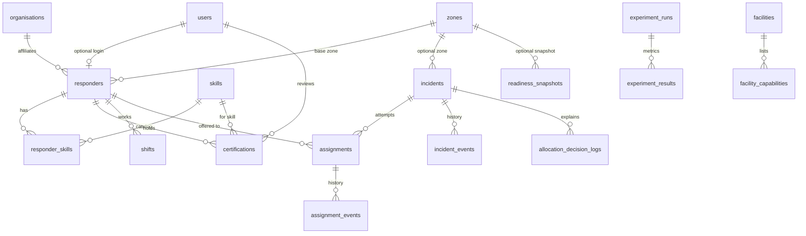

# CiviCare entity relationships

Guest reports have no `users` row. They are identified by `incidents.public_token`.

`responder_skills` is the catalogue link. Eligibility uses `certifications`, not the bridge table alone. A skill without a verified, in-date certification does not make a responder eligible.
